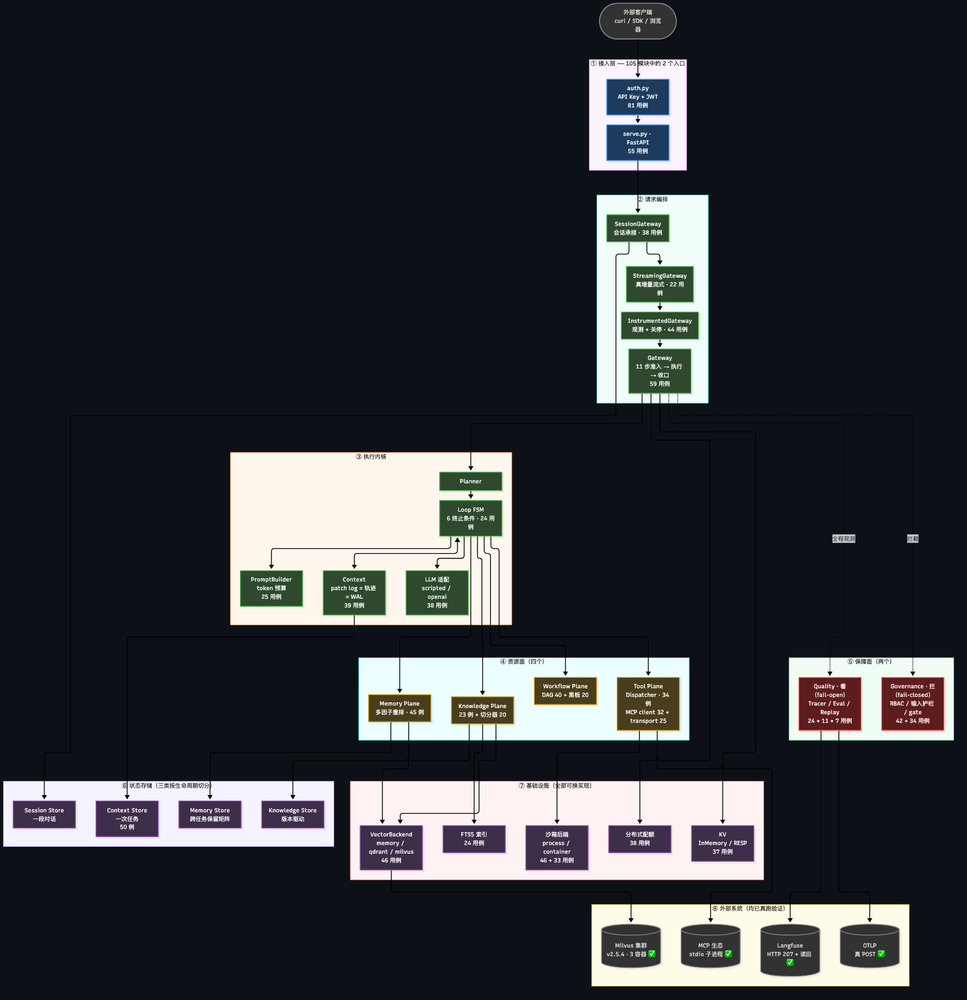
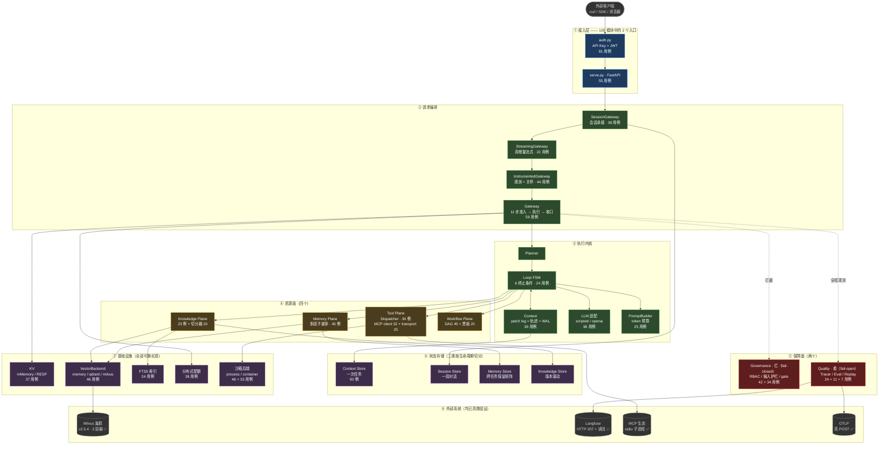
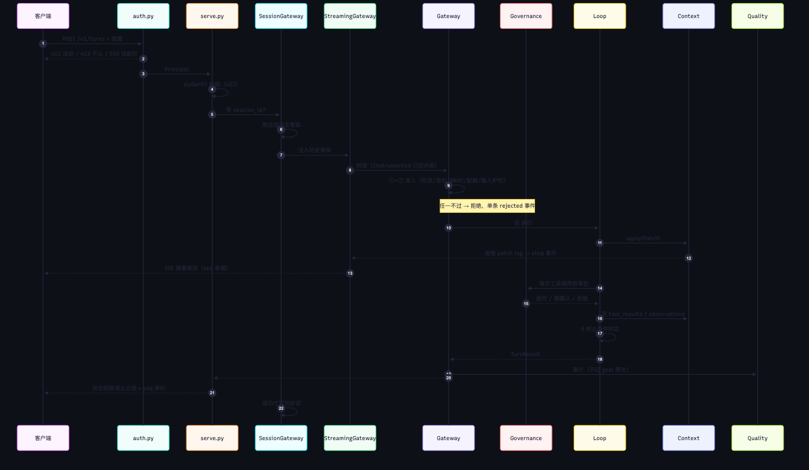
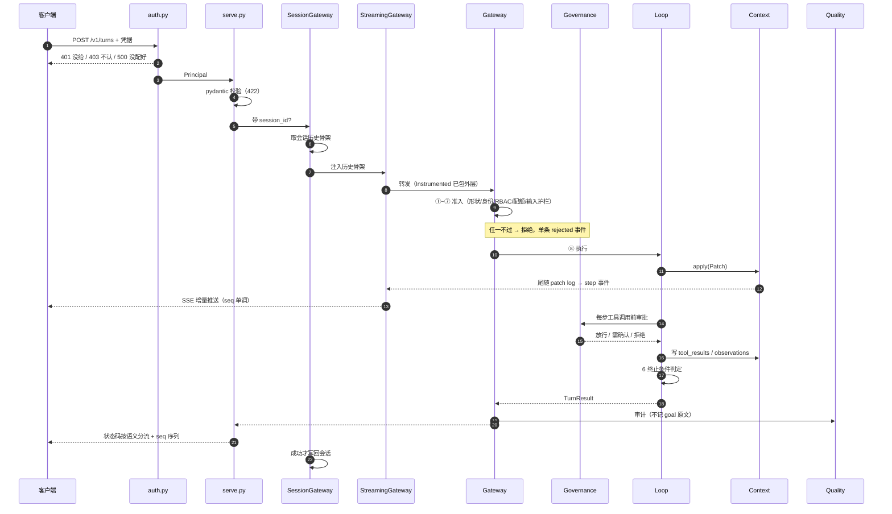
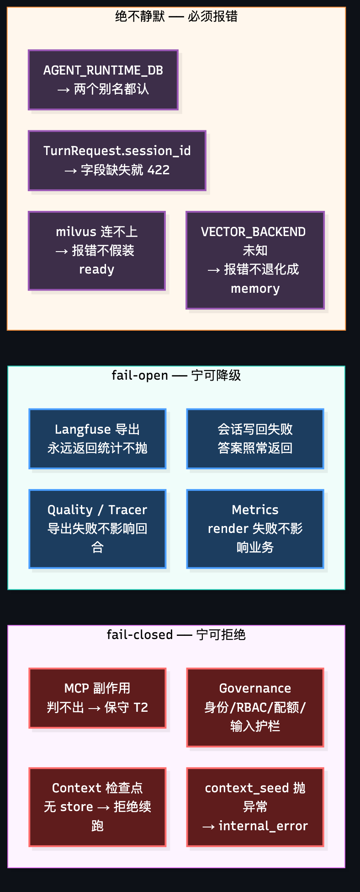
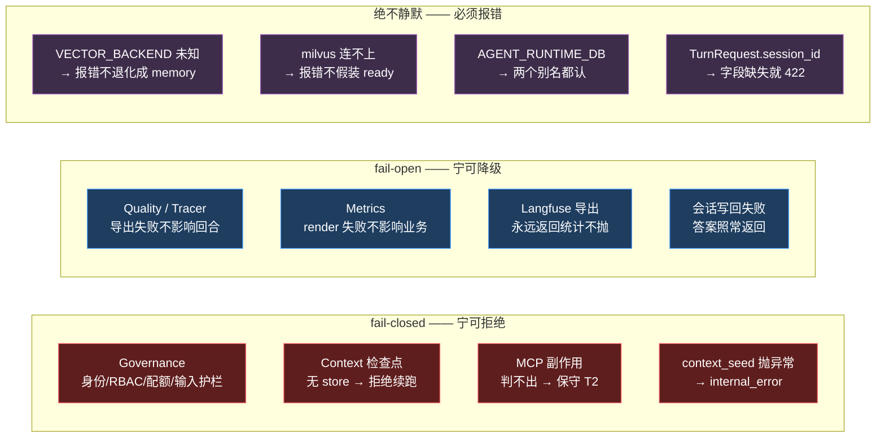
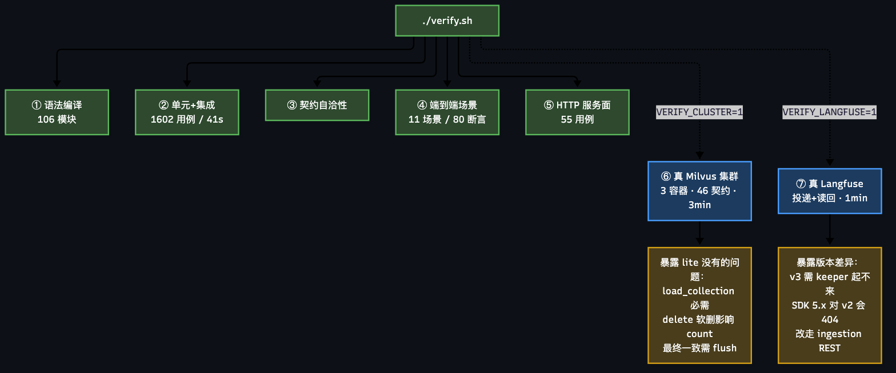
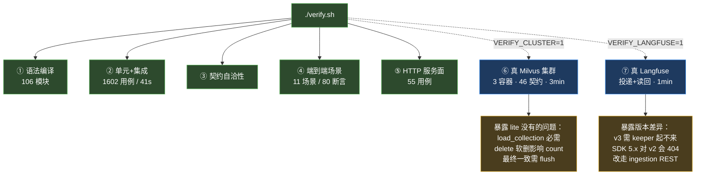

# Agent Runtime 全景状态图

> 数据来源：`./verify.sh`（1602 用例 / 11 场景 / 80 断言全绿）
> 最后更新：施工完成态

## 一、整体架构（一条主线 + 四资源面 + 两保障面）






## 二、一轮请求的完整时序（含所有检查点）






## 三、三种失败姿态（这是设计核心）






## 四、验证覆盖（七道门禁）






## 五、真跑验证过的外部系统

| 系统 | 方式 | 证据 | 脚本 |
|---|---|---|---|
| **Milvus 集群** | etcd + minio + milvus v2.5.4 | 46 契约全过 | `scripts/verify_milvus_cluster.sh` |
| **Langfuse** | v2 服务端 + ingestion API | HTTP 207、4 条成功、读回 3 obs | `scripts/verify_langfuse.sh` |
| **OTLP** | 本地 HTTP 接收器 | 真 POST、protobuf 可解、鉴权头透传 | `tests/test_otel_delivery.py` |
| **MCP stdio** | 真起子进程 server | discover / call / 崩溃 / 超时 | `tests/test_mcp_transport.py` |
| **Docker 沙箱** | 真起容器 | kernel 级隔离 | `tests/test_sandbox_backends.py` |
| **HTTP 服务** | 真端口 18080~18093 | 状态码分流、SSE seq、SIGTERM drain | 手工 + `tests/test_serve.py` |
| **多轮会话** | 真端口 + sqlite | `session_turns=2`、落盘只含 `{role,text}` | 手工 |
| **真实 LLM** | babelark 网关 | 中文 235~256 token（vs tiktoken 480） | `scripts/real_model_smoke.py` |

## 六、已知边界（诚实清单）

| 边界 | 影响 | 是否阻塞上线 |
|---|---|---|
| 鉴权默认关闭 | `authenticator=None` 时 principal 由请求体给 | **是** —— 必须配 `AGENT_RUNTIME_API_KEYS` |
| Langfuse 只验证到 ingestion 层 | SDK 5.x ↔ v2 服务端协议不通 | 否 —— 部署选 v3 即可 |
| 会话并发无序号互斥 | 同会话并发请求 `turn_index` 会重 | 否 —— 历史不丢 |
| MCP 只有 stdio | `streamable_http_client` 未验证 | 否 |
| HTTP 层无速率限制中间件 | 靠 Gateway 的租户配额 | 否 |
| `tiktoken` 中文高估 1.9x | 非 OpenAI 模型走启发式 Tokenizer | 否 —— 已标定 |

## 七、规模

```
106 模块  /  48 测试文件  /  5 脚本  /  60393 行
1602 用例  /  11 场景  /  80 断言
必需依赖 5  /  可选依赖 5
```

| 层 | 模块数 | 用例数（估） |
|---|---|---|
| 接入（serve/auth） | 2 | 136 |
| 编排（gateway/session/streaming/instrument） | 5 | 163 |
| 内核（loop/context/builder/llm） | 5 | 126 |
| 资源面（tool/memory/knowledge/workflow） | 12 | 297 |
| 保障面（governance/quality） | 3 | 122 |
| 存储（store/kv/vector/fts/dist） | 8 | 307 |
| 适配器（embeddings/mcp/tokenizer） | 4 | 137 |
| 其他（架构/集成/并发） | — | 314 |
